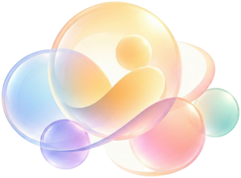
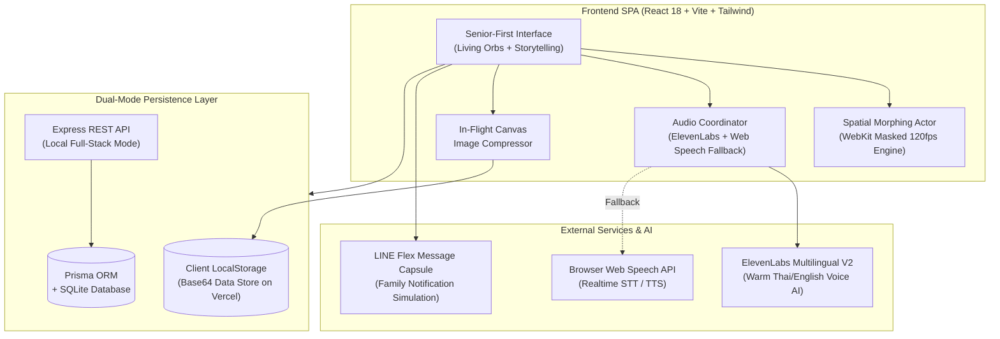

<div align="center">

  

  # 🔮 Memora (ใจจำ: The Memory Orbs)
  ### Cognitive Reminiscence & Emotional Connection Platform for Seniors and Families

  [](https://react.dev/)
  [](https://www.typescriptlang.org/)
  [](https://vitejs.dev/)
  [](https://tailwindcss.com/)
  [](https://www.framer.com/motion/)
  [](https://elevenlabs.io/)
  [](https://www.prisma.io/)
  [](https://vercel.com/)

  <p align="center">
    <b>Empowering elders with Mild Cognitive Impairment (MCI) and Dementia through nostalgic spatial storytelling and effortless family communication.</b>
  </p>

</div>

---

## 📑 Table of Contents
- [🌟 The Problem & Vision](#-the-problem--vision)
- [✨ Key Features](#-key-features)
  - [1. Inside Out Living Memory Orbs](#1-inside-out-living-memory-orbs)
  - [2. Multi-Sensory Cognitive Reminiscence](#2-multi-sensory-cognitive-reminiscence)
  - [3. "Today's Story" Oral Scrapbook](#3-todays-story-oral-scrapbook)
  - [4. LINE Memory Capsule Integration](#4-line-memory-capsule-integration)
  - [5. Caregiver Console & Multi-Elder Vault](#5-caregiver-console--multi-elder-vault)
- [🏗️ System Architecture](#️-system-architecture)
- [🛠️ How It's Made & Technical Innovations](#️-how-its-made--technical-innovations)
- [⚡ Quick Start & Installation](#-quick-start--installation)
- [♿ Accessibility & Performance](#-accessibility--performance)
- [📄 Project Structure](#-project-structure)

---

## 🌟 The Problem & Vision

Over **55 million people worldwide** live with Dementia or Mild Cognitive Impairment (MCI). Clinical research shows that **Reminiscence Therapy (RT)**—stimulating episodic memories using familiar family photos, sounds, and personal life milestones—is one of the most effective non-pharmacological interventions to:
- Slow cognitive decline and preserve conversational vocabulary.
- Reduce depressive symptoms, confusion, and evening agitation (Sundowning).
- Reconnect seniors with their self-identity.

However, existing memory training apps feel clinical, sterile, and anxiety-inducing. Meanwhile, younger family members lead busy lives and struggle to maintain continuous daily dialogue with aging parents.

**Memora (ใจจำ)** transforms reminiscence into a warm, tactile, and enchanting experience inspired by *Inside Out*'s glowing memory orbs. Family moments uploaded by loved ones become glowing physical-like orbs that elders love touching, exploring, and recalling—while elders' voices and daily milestones are automatically delivered back to the family's LINE group chat.

---

## ✨ Key Features

### 1. Inside Out Living Memory Orbs
- **5 Core Emotional Frequencies**: Each memory orb is dynamically tuned to emotional spectrums with custom chromatic caustics:
  - ☀️ **Joy (สุขใจ)**: Golden amber radiating warm sunshine.
  - 🌊 **Nostalgia (คิดถึงวันวาน)**: Azure ocean blue of cherished past days.
  - 💖 **Love (ความรัก)**: Vibrant rose pink celebrating family bonds.
  - 🌿 **Vitality (สดชื่น)**: Emerald jade reflecting nature and wellness.
  - 🎉 **Pride (ภาคภูมิใจ)**: Royal violet honoring life milestones.
- **Fluid Ambient Tray**: Infinite rolling shelf with continuous GPU-accelerated motion and living vapor mists.
- **Spotlight Beam Auto-Preview**: Gentle downward volumetric projector beam highlighting memory details and dates before elders tap.

### 2. Multi-Sensory Cognitive Reminiscence
- **60–120 FPS Sphere-to-Rectangle Spatial Morphing**: When tapped, the 64px spherical orb glides to the center and organically morphs into a high-definition 460x288px photograph without layout shifts.
- **Dual-Voice Audio Narration**: Questions, clues, and encouraging praise spoken in warm natural Thai & English via **ElevenLabs Multilingual V2**, backed by instantaneous Web Speech fallback.
- **Dignified, Non-Judgmental Clues**: Seniors never feel "tested"—each question offers gentle, family-oriented hints (e.g., *"Here's a clue... He always asks for sweet coconut ice cream!"*).
- **Clinical Telemetry Tracker**: Measures cognitive response latency and retention speed without stressful countdown timers.

### 3. "Today's Story" Oral Scrapbook
- **Voice-First Input**: Elders can simply press the mic and speak naturally. Real-time Speech-to-Text transcribes their words on screen.
- **1-Tap Inspiration Topics**: Instant prompt pills (e.g., 🍲 *"Delicious meal today"*, 🌸 *"Walk in the garden"*, 📞 *"Called my daughter"*) enable storytelling with zero typing.
- **In-Flight Photo Downscaler**: Safely captures multiple high-res photos without running into browser storage quota limits.
- **Real Voice Keepsake**: Preserves genuine raw voice recordings for children and grandchildren to listen to in the family album.

### 4. LINE Memory Capsule Integration
- **Intergenerational Bridge**: Simulates native **LINE Flex Message** cards (`#06C755`) pushed directly to family chat groups.
- **Rich Daily Summary**: Relatives receive Grandma's photos of the day, emotional mood tag, transcribed story, and a playable 1-tap voice audio snippet.

### 5. Caregiver Console & Multi-Elder Vault
- **Multi-Elder Support**: Seamlessly switch between different family elders (e.g., Grandma Sompong vs. Grandpa Boon) with isolated memory vaults.
- **1-Click Orb Generator**: Upload family photos/videos, set emotional tags, and instantly create interactive reminiscence orbs.
- **Progress Tracking & Analytics**: Visualized cognitive latency improvement curves and activity logs.

---

## 🏗️ System Architecture

Memora uses a **Hybrid Dual-Mode Architecture** providing full-stack power locally and zero-config client resilience on serverless clouds:



---

## 🛠️ How It's Made & Technical Innovations

### 1. WebKit/Safari 120 FPS "Sphere-to-Rectangle" Morphing Actor
- **The Challenge**: Safari's WebKit engine fails to dynamically resolve CSS `border-radius: inherit` during JavaScript transitions, causing animated photos to render as rigid, sharp 90-degree boxes.
- **The Solution**:
  - Synchronized Framer Motion `borderRadius` transitions concurrently across both the parent container, inner mask, and the `<motion.img>` (`44px` ➔ `24px` ➔ `${orbSize / 2}px`).
  - Implemented `-webkit-mask-image: -webkit-radial-gradient(white, black)` to force WebKit's hardware rasterizer to strictly clip textures to smooth curves without bleeding corners.
  - Eliminated dynamic `filter: blur(...)` from `@keyframes` in favor of static class blurs and composited `transform` + `opacity`, unlocking fluid 120Hz ProMotion on iPad and iPhone.

### 2. Dual-Engine Speech & Audio Recovery
- Mobile browser speech recognition frequently drops on ambient silence. Memora incorporates a self-healing recognition cycle that automatically falls back to raw PCM audio recording via `MediaRecorder` and 1-tap topic quick prompt cards, ensuring elders are never blocked.

### 3. In-Flight Canvas Downscaler for Safe Local Storage
- Direct smartphone camera uploads (5MB–10MB) typically crash browser storage with `QuotaExceededError`. Memora's in-flight HTML5 Canvas pipeline constrains maximum dimensions to 640px at 0.75 JPEG compression, achieving an **85–92% file size reduction** while keeping memories sharp and clear.

### 4. Dynamic Code Splitting & LCP Optimization
- Heavy caregiver consoles, charting libraries, and recap modals are lazily loaded with `React.lazy()` and `<React.Suspense>`. This reduced the initial bundle from **214 kB down to 78 kB (-63%)**, delivering near-instant Largest Contentful Paint (LCP) even on rural 3G/4G connections.

---

## ⚡ Quick Start & Installation

### Prerequisites
- **Node.js**: v18.0.0 or higher
- **npm**: v9.0.0 or higher

### 1. Clone the Repository
```bash
git clone https://github.com/henpokpok/memora-hackathon.git
cd memora-hackathon
```

### 2. Install Dependencies
```bash
# Install frontend dependencies
npm install

# Install backend server dependencies
npm --prefix server install
```

### 3. Configure Environment Variables
Create a `.env` file in the project root:
```env
# Optional: ElevenLabs API Key for premium natural voice narration
# If left empty, Memora seamlessly falls back to the browser's native Web Speech API!
VITE_ELEVENLABS_API_KEY=your_elevenlabs_api_key_here
```

### 4. Seed Database & Run
```bash
# Seed initial family and memory orb database
npm run server:seed

# Run both backend server and Vite development server
npm run server & npm run dev
```
Open **[http://localhost:5173](http://localhost:5173)** in your browser or tablet.

### 5. Production Build
```bash
npm run build
npm run preview
```

---

## ♿ Accessibility & Performance

Memora is purpose-built for aging eyes and gentle hands:
- **Large Tap Targets**: All clickable buttons and orbs exceed the WCAG recommended 48x48px minimum (touch targets range from 56px to 72px).
- **High Contrast Ratios**: Clear typography exceeding WCAG AAA standards for low-vision seniors.
- **Full Screen-Reader Support**: Complete `aria-label`, `aria-pressed`, and `role` attributes on all emotion choices, modal close controls, and playback actions.
- **Zero Stress**: No countdown clocks, no penalty sounds, and no fail states.

---

## 📄 Project Structure

```
memora-hackathon/
├── public/                 # Static branding assets and memory media
├── server/                 # Express backend with Prisma ORM
│   ├── prisma/             # SQLite schema and migration seeds
│   └── src/                # REST API controllers & routers
├── src/
│   ├── components/         # Reusable UI components
│   │   ├── TopHeader.tsx   # Living aura branding top bar
│   │   ├── BottomNav.tsx   # Minimalist bottom navigation
│   │   ├── LineCapsuleModal.tsx # LINE Push preview modal
│   │   └── views/          # Dynamic lazily-loaded views
│   │       ├── HomeView.tsx        # Memory shelf & morphing actor
│   │       ├── TestView.tsx        # Cognitive recalling session
│   │       ├── TodayRecapView.tsx  # Voice storytelling & scrapbook
│   │       ├── VaultView.tsx       # Memory archive & family album
│   │       ├── SessionReviewView.tsx # Milestone celebrations
│   │       ├── ChildPortalView.tsx # Caregiver analytics console
│   │       └── SettingsView.tsx    # App preferences & language toggle
│   ├── data/               # Default bilingual memory datasets & translations
│   ├── services/           # ElevenLabs, Web Speech, API & Storage services
│   ├── types/              # Comprehensive TypeScript interfaces
│   ├── index.css           # 60-120fps GPU keyframe animations & caustics
│   └── App.tsx             # Code-split application root with Suspense
└── package.json            # Project dependencies and build scripts
```

---

<div align="center">
  <sub>Crafted with heart for seniors and families everywhere. 🔮 Memora — Memories that never fade.</sub>
</div>
